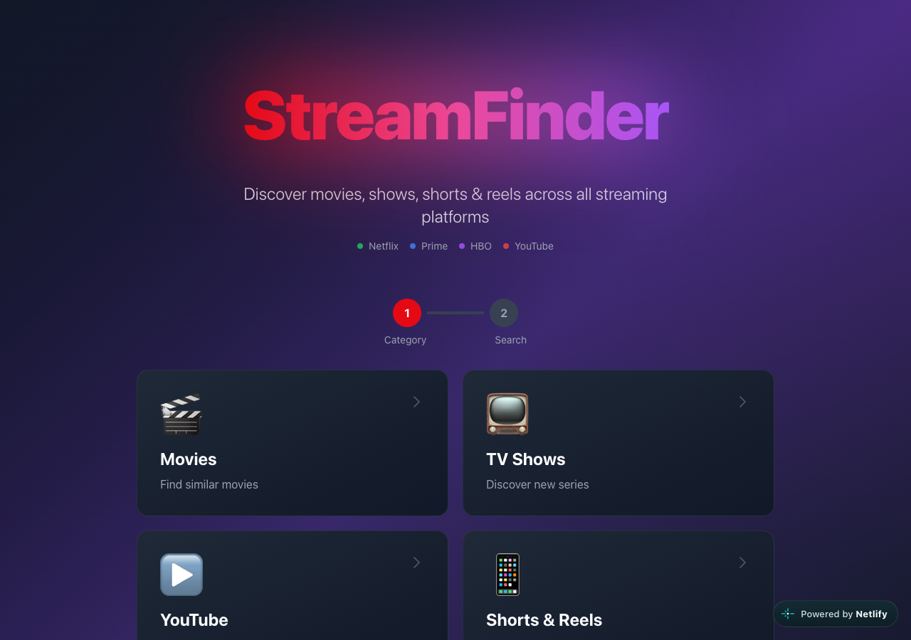
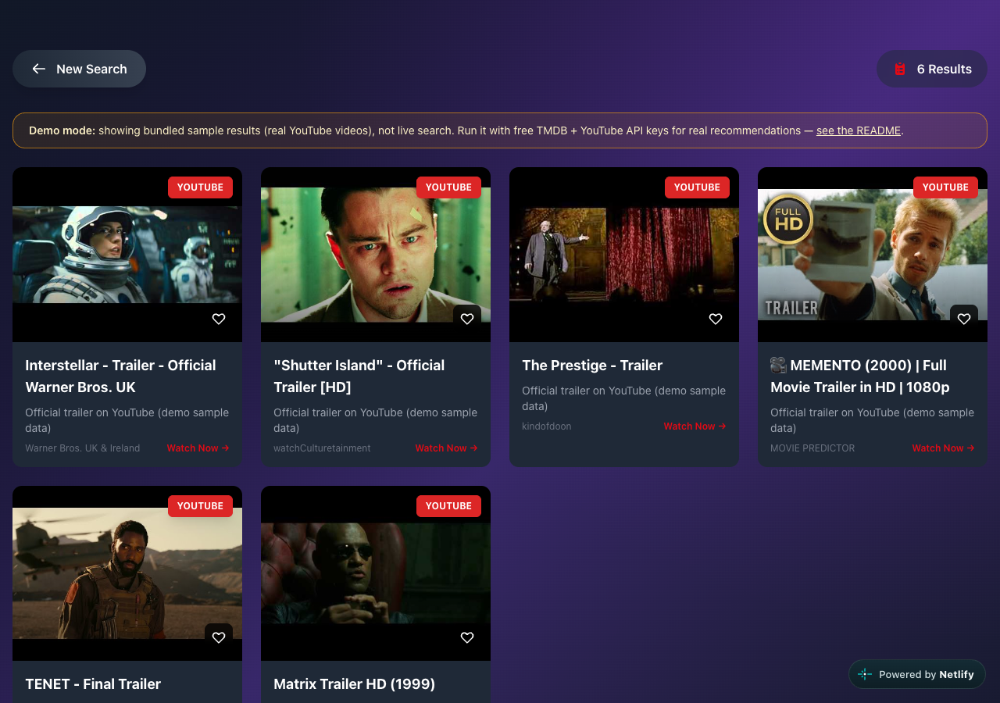

# StreamFinder

**Type a movie, show, YouTube topic or short and get similar picks, with where to watch each one.**

[](https://kush-streamfinder.netlify.app)
[](https://codespaces.new/KushagraKanaujia/streamfinder?quickstart=1)
[](LICENSE)


## Try it in one click

| Option | What you get | Needs |
| --- | --- | --- |
| **[Live demo](https://kush-streamfinder.netlify.app)** | The full UI in your browser, running on bundled sample data | Nothing |
| **[Open in Codespaces](https://codespaces.new/KushagraKanaujia/streamfinder?quickstart=1)** | Backend + frontend start by themselves, the UI opens in a preview tab | A GitHub account (Codespaces has a free monthly allowance) |
| [Run locally](#run-it-locally) | Same as Codespaces, on your own machine | Python 3.11, Node 18+ |

> **Demo mode.** With no API keys, StreamFinder serves a small set of bundled sample results
> (real public YouTube videos and trailers, listed in [`backend/app/sample_data.json`](backend/app/sample_data.json)),
> and a banner says so. Add two **free** keys (TMDB and YouTube Data API v3) to get live search and real recommendations.

<p align="center">
  
  
</p>

## What it does

1. Pick a category: **Movies**, **TV Shows**, **YouTube**, or **Shorts & Reels**.
2. Type what you like (for example *Inception*, *Breaking Bad*, *tech reviews*) and pick a region.
3. Get a grid of picks. Each card shows the platform, rating and year (when known), a hover panel with details, and a heart to save it to a watchlist kept in your browser.

## How it works

- **Movies / TV:** the backend finds your title on TMDB, gathers candidates from TMDB's similar titles and popular titles in the same genres, then scores each candidate on shared franchise, director, cast, genres, keywords, production companies, budget, runtime, rating and release year. It keeps only titles TMDB lists as available on a US streaming service and links to the platform. (The region picker currently affects YouTube searches.)
- **YouTube:** searches the YouTube Data API v3 by relevance.
- **Shorts & Reels:** searches YouTube for short videos matching the query (sorted by views).
- Results are cached in memory for 3 minutes. Searches and clicks are logged to SQLite (`/api/interactions`, summary at `/api/stats`).
- **No keys?** Every path falls back to the bundled sample data, and the frontend also falls back to it if the backend can't be reached.

```
React (Vite + Tailwind)  ──/api──▶  FastAPI  ──▶  TMDB API / YouTube Data API
        │                              │
        └─ demo.js (sample data)       └─ SQLite (interaction log), TTL cache
```

## Tech stack

- **Backend:** Python 3.11, FastAPI, SQLAlchemy (async) + aiosqlite, httpx, cachetools, pydantic-settings
- **Frontend:** React 18, Vite 5, Tailwind CSS 3
- **Data:** [TMDB API](https://developer.themoviedb.org/docs) (movies, TV, watch providers), [YouTube Data API v3](https://developers.google.com/youtube/v3)
- **Hosting:** Netlify (static demo), GitHub Codespaces (full stack)

## Run it locally

```bash
git clone https://github.com/KushagraKanaujia/streamfinder.git
cd streamfinder

# 1. Backend (http://localhost:8000, API docs at /docs)
cd backend
python3 -m venv venv && source venv/bin/activate   # Windows: venv\Scripts\activate
pip install -r requirements.txt
cp .env.example .env        # optional: add your free keys, or leave them blank for demo mode
uvicorn app.main:app --reload --port 8000

# 2. Frontend, in a second terminal (http://localhost:5173)
cd frontend
npm install
npm run dev
```

In development the frontend calls `/api/...` and Vite proxies it to the backend on port 8000.

**Free API keys (optional):**
- TMDB: create an account, then [Settings → API](https://www.themoviedb.org/settings/api)
- YouTube Data API v3: [enable it in Google Cloud Console](https://console.cloud.google.com/apis/library/youtube.googleapis.com) and create an API key (free daily quota)

In Codespaces you can add them as [Codespaces secrets](https://docs.github.com/en/codespaces/managing-your-codespaces/managing-your-account-specific-secrets-for-github-codespaces) named `TMDB_API_KEY` and `YOUTUBE_API_KEY`.

**Frontend environment variables**

| Variable | Effect |
| --- | --- |
| `VITE_DEMO_MODE=true` | Never call a backend; always use bundled sample data (used for the Netlify demo) |
| `VITE_API_URL` | Backend base URL for production builds (dev uses the Vite proxy) |

**Tests**

```bash
cd backend && pytest -q
```

## API

| Method | Path | Purpose |
| --- | --- | --- |
| `GET` | `/api/health` | Health check, reports `demo_mode` |
| `POST` | `/api/recommendations` | `{category: movies \| tv \| youtube \| tiktok, searchQuery, region, limit}` → results |
| `POST` | `/api/interactions` | Log a search or click |
| `GET` | `/api/stats` | Counts by category and click-through rate from the interaction log |

## Deploying the demo

The live demo is the frontend built in demo mode and uploaded with the Netlify CLI:

```bash
cd frontend
VITE_DEMO_MODE=true npm run build
netlify deploy --prod --dir=dist
```

`render.yaml` describes how to host the backend on Render if you want live results online.

## Project structure

```
streamfinder/
├── .devcontainer/          # GitHub Codespaces / Dev Containers setup
├── backend/
│   ├── app/
│   │   ├── main.py         # FastAPI app, CORS
│   │   ├── routes.py       # API endpoints
│   │   ├── services.py     # TMDB/YouTube calls, scoring, fallbacks
│   │   ├── sample_data.json# Demo-mode sample results
│   │   ├── config.py       # Settings from env / .env
│   │   ├── database.py     # Async SQLAlchemy setup
│   │   └── models.py       # Interaction log table
│   └── tests/
├── frontend/
│   └── src/
│       ├── App.jsx
│       ├── demo.js         # Demo mode (reads backend/app/sample_data.json)
│       └── components/     # FilterWizard, RecommendationCard, LoadingState
└── netlify.toml
```

## Credits

- Movie and TV data from [TMDB](https://www.themoviedb.org/). This product uses the TMDB API but is not endorsed or certified by TMDB.
- Video data from the [YouTube Data API](https://developers.google.com/youtube/v3).
- Codespaces setup uses the official [Dev Containers](https://github.com/devcontainers) Python image and Node feature (MIT).
- Badges by [shields.io](https://shields.io) (CC0).
- Built with [FastAPI](https://fastapi.tiangolo.com/), [React](https://react.dev/), [Vite](https://vitejs.dev/) and [Tailwind CSS](https://tailwindcss.com/).

## License

[MIT](LICENSE)
